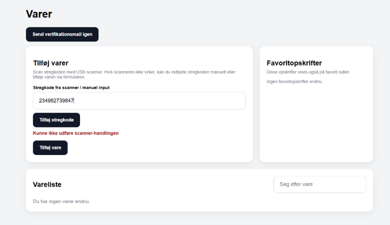
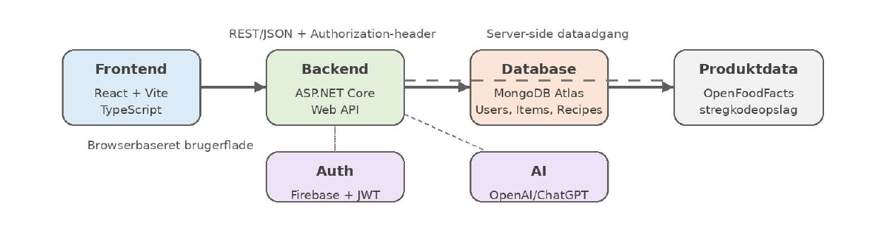

# SmartFridge

A full-stack web application developed as a fourth-semester Software Engineering project at Aarhus University.

SmartFridge helps users manage food items in their household and generate recipe suggestions based on the ingredients they already have available.

## Preview

## Features

- User registration and authentication
- Food inventory management
- Barcode-based product lookup
- Recipe generation based on available ingredients
- User-specific data and access control
- Integration with external APIs

## Tech Stack

### Backend
- C#
- ASP.NET Core Web API
- REST APIs
- MongoDB
- Firebase Authentication
- JWT-based authentication

### Frontend
- React
- JavaScript (JSX)
- Vite

### Testing
- xUnit
- Moq
- WebApplicationFactory
- Integration testing
- API testing

### Tools & Deployment
- Git
- Docker
- Render
- MongoDB Atlas

## Architecture

The application is structured as a client-server system with separate frontend, backend and database components.

The backend follows a layered architecture with:

- Controllers for handling API requests
- Services for business logic
- Repositories for database access
- Models and DTOs for data transfer

The backend also acts as the integration layer between the frontend, MongoDB, Firebase Authentication and external APIs.

## External Services

The application integrates with:

- Firebase Authentication for user authentication
- Open Food Facts for barcode-based product information
- OpenAI API for recipe generation

